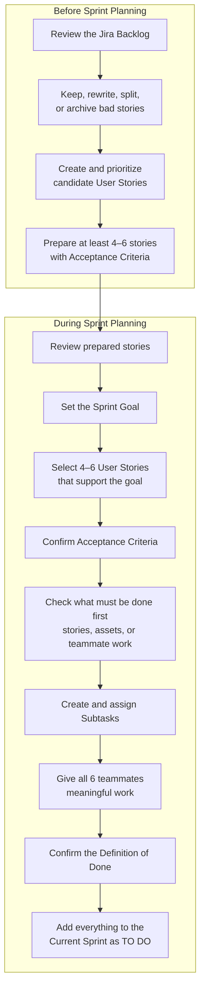
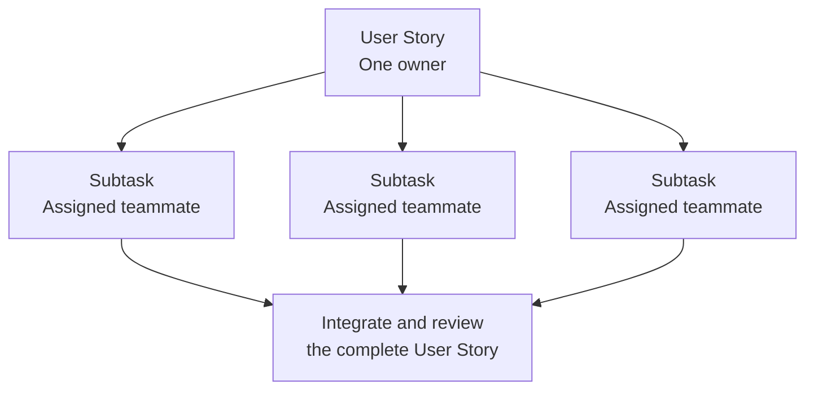
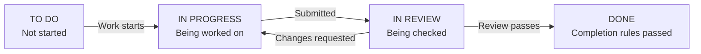

# Sprint Planning

Our six-person team selects **4–6 User Stories per Sprint**. Every teammate must complete meaningful assigned work through a User Story or Subtask.

## Planning Flow

Sprint Planning answers:

- **Why?** The Sprint Goal.
- **What?** The 4–6 selected User Stories.
- **How?** Subtasks, assignments, dependencies, and completion rules.

## Assignment

One teammate owns each User Story. Its Subtasks may be assigned to other teammates.

All six teammates must complete something that can be shown in the **Sprint Review** and discussed in the **Sprint Retrospective**.

## Acceptance Criteria and Definition of Done

| Term | Meaning |
| --- | --- |
| **Acceptance Criteria** | Testable requirements for one specific User Story. Store them in that Jira story's description. |
| **Definition of Done** | The shared completion rules applied to every User Story. |

A **Subtask** is Done when its work passes review.

A **User Story** is Done when:

- Its required Subtasks are Done.
- Its Acceptance Criteria pass.
- The complete, integrated story passes review.

## Sprint Workflow

## Sprint Planning Output

At the end of the meeting, the team has:

- One Sprint Goal.
- 4–6 selected User Stories with Acceptance Criteria.
- Created and assigned Subtasks.
- Meaningful work for all six teammates.
- A Current Sprint ready to start in `TO DO`.

## Quick Terminology

| Term | Meaning |
| --- | --- |
| **Vision Document** | The project's goals and functional requirements. |
| **Product Backlog** | Prioritized User Stories that may be completed in future Sprints. |
| **User Story** | A small feature described from the user's point of view. |
| **Sprint** | A fixed period for completing selected work. |
| **Sprint Goal** | The main outcome the team wants from the Sprint. |
| **Subtask** | A smaller action needed to complete a User Story. |
| **Assignee** | The teammate responsible for a User Story or Subtask. |
| **Dependency** | Work or an asset that must be ready before other work can continue. |
| **Sprint Review** | Demonstrate completed work and collect feedback. |
| **Sprint Retrospective** | Discuss teamwork, problems, and improvements for the next Sprint. |
